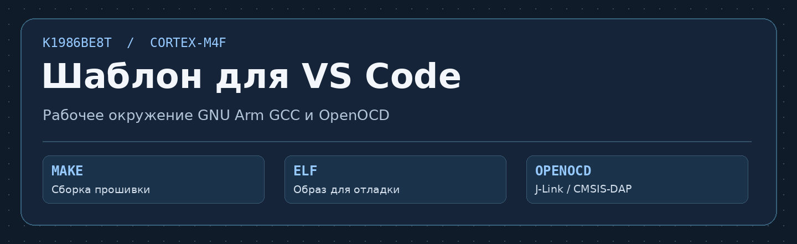

# К1986ВЕ8Т · шаблон проекта для VS Code

Шаблон для микроконтроллера **К1986ВЕ8Т** с ядром **Arm Cortex-M4F**. Внутри минимальная прошивка с миганием светодиодов, GNU Makefile и два профиля запуска отладки из RAM. Один рассчитан на **CMSIS-DAP**, другой на **J-Link**.

## Быстрый старт

Понадобятся GNU Arm Embedded GCC (`arm-none-eabi-gcc`), GNU Make и утилиты `find`, `mkdir`, `rm` из POSIX-окружения. Для отладки установите OpenOCD Миландр и расширение **Cortex-Debug** в VS Code. Добавьте инструменты в PATH. На Windows можно использовать xPack Windows Build Tools.

1. Скачайте [K1986BE8T_Template.zip][archive] и восстановите файлы поддержки из архива.

   ```console
   python tools/import_sdk.py K1986BE8T_Template.zip
   ```

   Скрипт импортирует `Library/`, `openocd/` и `svd/`.

2. Соберите прошивку из корня проекта или запустите задачу **Build** в VS Code.

   ```console
   make -j
   ```

   Результаты в `build/` включают ELF для отладки, BIN, HEX и листинг. Имя по умолчанию — `K1986BE8T_Template`. При сборке из VS Code имя задаётся в [settings.json](.vscode/settings.json).

3. Подключите JTAG-адаптер. Выберите подходящий профиль в **Run and Debug**. Если OpenOCD отсутствует в PATH, укажите путь к исполняемому файлу в `OPENOCD_EXECUTABLE` в настройках проекта.
4. После запуска отладчик остановится в `main()`. При продолжении работы на плате должны мигать светодиоды, подключённые к PC16–PC18.

| Файл | Назначение |
| --- | --- |
| [src/main.c](src/main.c) | Минимальный пример работы с GPIO |
| [makefile](makefile) | Сборка Cortex-M4F и формирование файлов прошивки |
| [linker/K1986BE8T.ld](linker/K1986BE8T.ld) | Размещение отладочного образа в RAM |
| [.vscode/launch.json](.vscode/launch.json) | Профили J-Link и CMSIS-DAP с запуском в RAM |

Сборка проверена на Linux с xPack Arm GCC 13.3.1. Она проходит с предупреждениями в файлах поддержки из архива. Подключение программаторов и запуск на плате при подготовке репозитория не проверялись.

Автор статьи — **Илья Лампадов**. Файлы поддержки, SVD и сценарии OpenOCD берутся из оригинального архива. Линкерный скрипт содержит уведомление об авторских правах Arm и распространяется по [Apache-2.0](LICENSES/Apache-2.0.txt). [Статья и оригинальный шаблон][article].

[article]: https://support.milandr.ru/base/primenenie/programmirovanie-32-razryadnykh-mk/nachalo-raboty/65986/
[archive]: https://support.milandr.ru/upload/iblock/099/0yzqc1soot4rlkdjab21g239x9yyucvh/K1986BE8T_Template.zip
